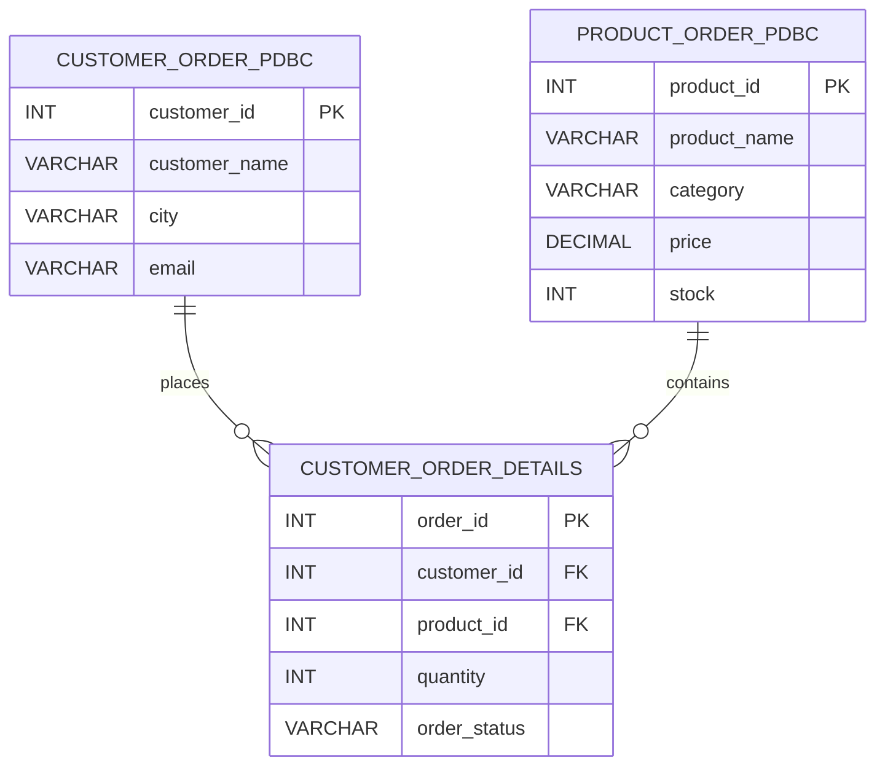

# Assignment 1: Online Shopping Order Management System

## 1. Introduction

An online shopping company wants to manage customers, products, and orders using **Python Database Connectivity (PDBC)**.

The application is a menu-driven program that performs database operations using Python and MySQL.

### Technologies Used

- Python
- MySQL
- `mysql.connector`

---

## 2. Database Design

The system consists of three tables:

1. `customer_order_pdbc`
2. `product_order_pdbc`
3. `customer_order_details`

### Table 1: customer_order_pdbc

Stores customer information.

| Column Name | Data Type | Constraint |
|---|---|---|
| customer_id | INT | PRIMARY KEY |
| customer_name | VARCHAR(60) | |
| city | VARCHAR(40) | |
| email | VARCHAR(80) | |

**Sample Data**

| customer_id | customer_name | city | email |
|---:|---|---|---|
| 1 | Amit | Indore | amit@gmail.com |
| 2 | Priya | Bhopal | priya@gmail.com |
| 3 | Rahul | Indore | rahul@gmail.com |
| 4 | Neha | Ujjain | neha@gmail.com |
| 5 | Karan | Dewas | karan@gmail.com |

### Table 2: product_order_pdbc

Stores product information.

| Column Name | Data Type | Constraint |
|---|---|---|
| product_id | INT | PRIMARY KEY |
| product_name | VARCHAR(80) | |
| category | VARCHAR(40) | |
| price | DECIMAL(10,2) | |
| stock | INT | |

**Sample Data**

| product_id | product_name | category | price | stock |
|---:|---|---|---:|---:|
| 101 | Laptop | Electronics | 55000.00 | 10 |
| 102 | Mouse | Electronics | 800.00 | 50 |
| 103 | Keyboard | Electronics | 1500.00 | 30 |
| 104 | Notebook | Stationery | 100.00 | 100 |
| 105 | Monitor | Electronics | 12000.00 | 15 |
| 106 | Pen | Stationery | 20.00 | 200 |

### Table 3: customer_order_details

Stores customer order information.

| Column Name | Data Type | Constraint |
|---|---|---|
| order_id | INT | PRIMARY KEY |
| customer_id | INT | FOREIGN KEY |
| product_id | INT | FOREIGN KEY |
| quantity | INT | |
| order_status | VARCHAR(30) | |

**Foreign Key Relationships**

- `customer_id` references `customer_order_pdbc(customer_id)`.
- `product_id` references `product_order_pdbc(product_id)`.

**Sample Data**

| order_id | customer_id | product_id | quantity | order_status |
|---:|---:|---:|---:|---|
| 1001 | 1 | 101 | 1 | Delivered |
| 1002 | 1 | 102 | 2 | Delivered |
| 1003 | 2 | 103 | 1 | Shipped |
| 1004 | 3 | 105 | 2 | Delivered |
| 1005 | 3 | 104 | 5 | Pending |
| 1006 | 4 | 101 | 1 | Pending |
| 1007 | 5 | 106 | 10 | Delivered |

### Entity Relationship Diagram



---

## 3. Menu-Driven Program

The application provides the following operations:

```text
===== ONLINE SHOPPING ORDER MANAGEMENT =====

1. Add Customer
2. Add Product
3. Place Order
4. Display All Orders with Customer and Product Details
5. Search Customer by Name
6. Update Product Price
7. Update Order Status
8. Delete Order
9. Display Customer-wise Total Purchase Amount
10. Display Products Costing More Than Average Product Price
11. Display Customers Who Have Placed at Least One Order
12. Display Customers Who Have Not Placed Any Order
13. Exit

Enter your choice:
```

---

## 4. Tasks and Expected Input/Output

### Task 1: Add Customer

**Input**

```text
Enter your choice: 1
Enter Customer ID: 6
Enter Customer Name: Anjali
Enter City: Indore
Enter Email: anjali@gmail.com
```

**Expected Output**

```text
Customer inserted successfully.
```

### Task 2: Add Product

**Input**

```text
Enter your choice: 2
Enter Product ID: 107
Enter Product Name: Headphones
Enter Category: Electronics
Enter Price: 2500
Enter Stock: 25
```

**Expected Output**

```text
Product inserted successfully.
```

### Task 3: Place Order

**Input**

```text
Enter your choice: 3
Enter Order ID: 1008
Enter Customer ID: 6
Enter Product ID: 107
Enter Quantity: 2
Enter Order Status: Pending
```

**Expected Output**

```text
Order placed successfully.
```

### Task 4: Display All Orders Using INNER JOIN

**Required Operation**

Display the following information:

- Order ID
- Customer Name
- Product Name
- Quantity
- Price
- Calculated Amount
- Order Status

**SQL Concepts**

- INNER JOIN
- Multiple table joins
- Column aliases
- Calculated columns

**Formula**

```text
Calculated Amount = Quantity * Price
```

**Expected Output**

| Order ID | Customer Name | Product Name | Quantity | Price | Amount | Status |
|---:|---|---|---:|---:|---:|---|
| 1001 | Amit | Laptop | 1 | 55000.00 | 55000.00 | Delivered |
| 1002 | Amit | Mouse | 2 | 800.00 | 1600.00 | Delivered |
| 1003 | Priya | Keyboard | 1 | 1500.00 | 1500.00 | Shipped |
| 1004 | Rahul | Monitor | 2 | 12000.00 | 24000.00 | Delivered |
| 1005 | Rahul | Notebook | 5 | 100.00 | 500.00 | Pending |
| 1006 | Neha | Laptop | 1 | 55000.00 | 55000.00 | Pending |
| 1007 | Karan | Pen | 10 | 20.00 | 200.00 | Delivered |

### Task 5: Search Customer Using LIKE

**Input**

```text
Enter your choice: 5
Enter customer name to search: an
```

**SQL Concept:** `LIKE` operator.

**Required SQL Condition**

```sql
WHERE customer_name LIKE '%an%'
```

**Expected Output**

| Customer ID | Customer Name | City |
|---:|---|---|
| 1 | Amit | Indore |
| 5 | Karan | Dewas |

The result may include customer names containing the entered search text.

### Task 6: Update Product Price

**Input**

```text
Enter your choice: 6
Enter Product ID: 102
Enter New Price: 900
```

**Expected Output**

```text
Product price updated successfully.
```

### Task 7: Update Order Status

**Input**

```text
Enter your choice: 7
Enter Order ID: 1005
Enter New Status: Delivered
```

**Expected Output**

```text
Order status updated successfully.
```

### Task 8: Delete Order

**Input**

```text
Enter your choice: 8
Enter Order ID: 1007
```

**Expected Output**

```text
Order deleted successfully.
```

### Task 9: Display Customer-wise Total Purchase Amount

**Required SQL Concepts**

- INNER JOIN
- GROUP BY
- SUM()
- ORDER BY

**Required Output Columns**

- Customer ID
- Customer Name
- Total Purchase Amount

**Formula**

```text
SUM(order_quantity * product_price)
```

**Expected Output**

| Customer ID | Customer Name | Total Purchase Amount |
|---:|---|---:|
| 1 | Amit | 56600.00 |
| 2 | Priya | 1500.00 |
| 3 | Rahul | 24500.00 |
| 4 | Neha | 55000.00 |
| 5 | Karan | 200.00 |

### Task 10: Display Products Costing More Than Average Price

**Question:** Display products whose price is greater than the average price of all products.

**Required SQL Concept:** Single-row subquery.

**Expected Output**

| Product ID | Product Name | Price |
|---:|---|---:|
| 101 | Laptop | 55000.00 |
| 105 | Monitor | 12000.00 |

### Task 11: Display Customers Who Have Placed at Least One Order

**Question:** Display customers who have placed at least one order.

**Required SQL Concepts**

- Subquery
- IN operator or EXISTS operator

**Expected Output**

| Customer ID | Customer Name |
|---:|---|
| 1 | Amit |
| 2 | Priya |
| 3 | Rahul |
| 4 | Neha |
| 5 | Karan |

### Task 12: Display Customers Who Have Not Placed Any Order

**Question:** Display customers who have never placed an order.

**Required SQL Concepts**

- LEFT JOIN
- IS NULL
- NOT EXISTS subquery

**Expected Output**

| Customer ID | Customer Name |
|---:|---|
| 6 | Anjali |

**Note:** This output assumes customer 6 has been inserted but has not placed any order.

### Task 13: Foreign Key Constraint Test

Try to place an order using a customer ID that does not exist in the parent table.

**Input**

```text
Enter your choice: 3
Enter Order ID: 1009
Enter Customer ID: 999
Enter Product ID: 101
Enter Quantity: 1
Enter Order Status: Pending
```

**Expected Output**

```text
Order could not be inserted because the customer ID
does not exist in the parent table.
```

**Learning Outcome:** Understand how foreign key constraints maintain referential integrity between related tables.

### Task 14: Menu Validation

If the user enters an invalid menu choice:

**Input**

```text
Enter your choice: 20
```

**Expected Output**

```text
Invalid choice. Please try again.
```

---

## 5. SQL Concepts Covered

| No. | SQL Concept | Application |
|---:|---|---|
| 1 | PRIMARY KEY | Unique identification of records |
| 2 | FOREIGN KEY | Establishing relationships between tables |
| 3 | INSERT | Adding customers, products, and orders |
| 4 | SELECT | Retrieving records |
| 5 | INNER JOIN | Displaying order details |
| 6 | LEFT JOIN | Finding customers without orders |
| 7 | WHERE | Filtering records |
| 8 | LIKE | Searching customers by name |
| 9 | UPDATE | Updating product prices and order status |
| 10 | DELETE | Deleting orders |
| 11 | GROUP BY | Grouping purchases customer-wise |
| 12 | SUM() | Calculating total purchase amounts |
| 13 | AVG() | Calculating average product price |
| 14 | ORDER BY | Sorting query results |
| 15 | Subquery | Finding products and customers using nested queries |
| 16 | IN / EXISTS | Checking customer order records |
| 17 | IS NULL | Finding customers without orders |

---

## 6. Learning Outcomes

After completing this assignment, students will be able to:

- Establish a connection between Python and MySQL using `mysql.connector`.
- Perform CRUD operations using Python Database Connectivity.
- Execute SQL queries through Python.
- Implement primary key and foreign key constraints.
- Work with INNER JOIN and LEFT JOIN.
- Perform aggregate operations using `SUM()` and `AVG()`.
- Understand GROUP BY and ORDER BY.
- Implement subqueries using IN and EXISTS.
- Handle database constraint errors.
- Develop a menu-driven database application.

---

## 7. Conclusion

The Online Shopping Order Management System demonstrates the practical implementation of Python Database Connectivity (PDBC) with MySQL.

It combines database operations, table relationships, joins, aggregate functions, subqueries, and exception handling in a single menu-driven application.

This assignment helps students understand how Python applications interact with relational databases in real-world scenarios.