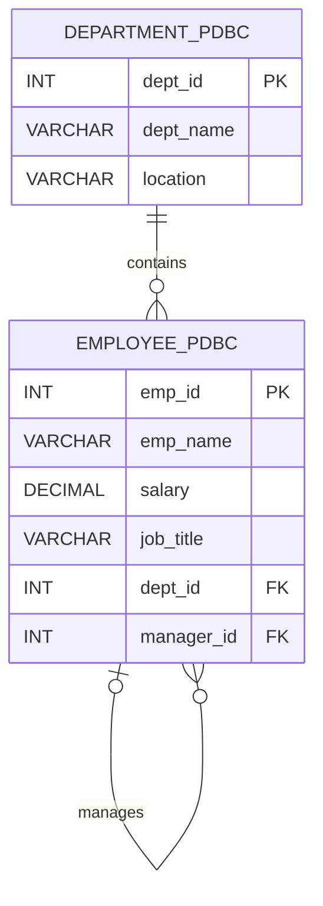

# Assignment 2: Company Department and Employee Analysis System

## 1. Introduction

A company wants to manage its departments and employees using Python Database Connectivity (PDBC).

The system should support employee CRUD operations and analytical queries using joins, foreign keys, aggregate functions, and subqueries.

The application is a menu-driven program that performs database operations using Python and MySQL.

### Technologies Used

- Python
- MySQL
- `mysql.connector`

---

## 2. Concepts to Practice

1. Primary Key
2. Foreign Key
3. INSERT, SELECT, UPDATE, DELETE
4. INNER JOIN
5. LEFT JOIN
6. SELF JOIN
7. GROUP BY
8. HAVING
9. Aggregate Functions
10. Single-row Subquery
11. Multi-row Subquery
12. Correlated Subquery
13. LIKE Operator
14. Menu-driven PDBC Program

---

## 3. Database Design

The system consists of two tables:

1. `department_pdbc`
2. `employee_pdbc`

### Table 1: department_pdbc

Stores department information.

| Column Name | Data Type | Constraint |
|---|---|---|
| dept_id | INT | PRIMARY KEY |
| dept_name | VARCHAR(50) | |
| location | VARCHAR(40) | |

**Sample Data**

| dept_id | dept_name | location |
|---:|---|---|
| 1 | IT | Indore |
| 2 | HR | Bhopal |
| 3 | Finance | Indore |
| 4 | Sales | Ujjain |
| 5 | Training | Dewas |

### Table 2: employee_pdbc

Stores employee information.

| Column Name | Data Type | Constraint |
|---|---|---|
| emp_id | INT | PRIMARY KEY |
| emp_name | VARCHAR(60) | |
| salary | DECIMAL(10,2) | |
| job_title | VARCHAR(50) | |
| dept_id | INT | FOREIGN KEY |
| manager_id | INT | SELF-REFERENCING FOREIGN KEY, NULL |

**Foreign Key Relationships**

- `dept_id` references `department_pdbc(dept_id)`.
- `manager_id` references `employee_pdbc(emp_id)`.

**Sample Data**

| emp_id | emp_name | salary | job_title | dept_id | manager_id |
|---:|---|---:|---|---:|---|
| 101 | Amit | 70000.00 | Developer | 1 | NULL |
| 102 | Priya | 55000.00 | Tester | 1 | 101 |
| 103 | Rahul | 90000.00 | Manager | 1 | NULL |
| 104 | Neha | 45000.00 | HR Executive | 2 | NULL |
| 105 | Karan | 80000.00 | Finance Manager | 3 | NULL |
| 106 | Anjali | 50000.00 | Accountant | 3 | 105 |
| 107 | Vijay | 40000.00 | Sales Executive | 4 | NULL |
| 108 | Pooja | 60000.00 | Trainer | 5 | NULL |

### Entity Relationship Diagram



---

## 4. Menu-Driven Program

The application provides the following operations:

```text
===== COMPANY EMPLOYEE MANAGEMENT SYSTEM =====

1. Add Department
2. Add Employee
3. Display All Employees with Department
4. Search Employee by Name
5. Update Employee Salary
6. Update Employee Department
7. Delete Employee
8. Display Department-wise Employee Count
9. Display Department-wise Average Salary
10. Display Employees Earning More Than Average Salary
11. Display Employees Earning More Than Their Department Average
12. Display Employees Working in the IT Department
13. Display Departments Having More Than One Employee
14. Display Employee and Manager Names using Self Join
15. Display Departments with No Employees
16. Test Foreign Key Constraint
17. Exit

Enter your choice:
```

---

## 5. Tasks and Expected Input/Output

### Task 1: Add Department

**Input**

```text
Enter your choice: 1
Enter Department ID: 6
Enter Department Name: Research
Enter Location: Indore
```

**Expected Output**

```text
Department inserted successfully.
```

### Task 2: Add Employee

**Input**

```text
Enter your choice: 2
Enter Employee ID: 109
Enter Employee Name: Rohan
Enter Salary: 48000
Enter Job Title: Developer
Enter Department ID: 6
Enter Manager ID: 101
```

**Expected Output**

```text
Employee inserted successfully.
```

### Task 3: Display Employees with Department Using INNER JOIN

**Required Output Columns**

- Employee ID
- Employee Name
- Job Title
- Salary
- Department Name
- Location

**SQL Concepts**

- INNER JOIN
- Multiple table relationships

**Expected Output**

| Emp ID | Employee Name | Job Title | Salary | Department |
|---:|---|---|---:|---|
| 101 | Amit | Developer | 70000.00 | IT |
| 102 | Priya | Tester | 55000.00 | IT |
| 103 | Rahul | Manager | 90000.00 | IT |
| 104 | Neha | HR Executive | 45000.00 | HR |
| 105 | Karan | Finance Manager | 80000.00 | Finance |
| 106 | Anjali | Accountant | 50000.00 | Finance |
| 107 | Vijay | Sales Executive | 40000.00 | Sales |
| 108 | Pooja | Trainer | 60000.00 | Training |

### Task 4: Search Employee by Name Using LIKE

**Input**

```text
Enter your choice: 4
Enter employee name to search: an
```

**Required SQL Condition**

```sql
WHERE emp_name LIKE '%an%'
```

**SQL Concept:** LIKE operator.

**Expected Output**

| Emp ID | Employee Name | Job Title | Salary |
|---:|---|---|---:|
| 101 | Amit | Developer | 70000.00 |
| 106 | Anjali | Accountant | 50000.00 |

The result may include employee names containing the entered search text.

### Task 5: Update Employee Salary

**Input**

```text
Enter your choice: 5
Enter Employee ID: 102
Enter New Salary: 60000
```

**Expected Output**

```text
Employee salary updated successfully.
```

### Task 6: Update Employee Department

**Input**

```text
Enter your choice: 6
Enter Employee ID: 107
Enter New Department ID: 5
```

**Expected Output**

```text
Employee department updated successfully.
```

### Task 7: Delete Employee

**Input**

```text
Enter your choice: 7
Enter Employee ID: 108
```

**Expected Output**

```text
Employee deleted successfully.
```

### Task 8: Display Department-wise Employee Count

**Required SQL Concepts**

- INNER JOIN
- GROUP BY
- COUNT()

**Expected Output**

| Department | Employee Count |
|---|---:|
| IT | 3 |
| HR | 1 |
| Finance | 2 |
| Sales | 1 |
| Training | 1 |

### Task 9: Display Department-wise Average Salary

**Required SQL Concepts**

- INNER JOIN
- GROUP BY
- AVG()

**Expected Output**

| Department | Average Salary |
|---|---:|
| IT | 71666.67 |
| HR | 45000.00 |
| Finance | 65000.00 |
| Sales | 40000.00 |
| Training | 60000.00 |

### Task 10: Employees Earning More Than Overall Average Salary

**Question:** Display employees whose salary is greater than the average salary of all employees.

**Required SQL Concept:** Single-row subquery.

**Expected Output**

| Emp ID | Employee Name | Salary |
|---:|---|---:|
| 101 | Amit | 70000.00 |
| 103 | Rahul | 90000.00 |
| 105 | Karan | 80000.00 |
| 108 | Pooja | 60000.00 |

**Note:** The exact output changes if students update or delete records.

### Task 11: Employees Earning More Than Their Department Average

**Question:** Display employees whose salary is greater than the average salary of their own department.

**Required SQL Concept:** Correlated subquery.

**Expected Output**

| Emp ID | Employee Name | Department | Salary |
|---:|---|---|---:|
| 103 | Rahul | IT | 90000.00 |
| 105 | Karan | Finance | 80000.00 |

### Task 12: Display Employees Working in IT Department

**Question:** Display all employees who work in the IT department.

**Required SQL Concept:** Subquery returning one value.

**Expected Output**

| Emp ID | Employee Name | Salary |
|---:|---|---:|
| 101 | Amit | 70000.00 |
| 102 | Priya | 55000.00 |
| 103 | Rahul | 90000.00 |

### Task 13: Departments Having More Than One Employee

**Required SQL Concepts**

- JOIN
- GROUP BY
- HAVING

**Expected Output**

| Department | Employee Count |
|---|---:|
| IT | 3 |
| Finance | 2 |

### Task 14: Display Employee and Manager Names Using SELF JOIN

**Question:** Display employee name and manager name.

**Required SQL Concept:** SELF JOIN.

**Expected Output**

| Employee Name | Manager Name |
|---|---|
| Priya | Amit |
| Anjali | Karan |

### Task 15: Display Departments with No Employees

**Question:** Display departments that do not have any employees.

**Required SQL Concepts**

- LEFT JOIN
- IS NULL

**Expected Output**

| Department ID | Department Name |
|---:|---|
| 6 | Research |

**Note:** This output assumes department 6 was inserted and no employee has yet been assigned to it.

### Task 16: Foreign Key Constraint Test

Try to insert an employee with a department ID that does not exist in the parent table.

**Input**

```text
Enter your choice: 2
Enter Employee ID: 110
Enter Employee Name: Suresh
Enter Salary: 42000
Enter Job Title: Tester
Enter Department ID: 999
Enter Manager ID: 101
```

**Expected Output**

```text
Employee could not be inserted because the department ID
does not exist in the parent table.
```

**Additional Foreign Key Tests**

- Updating an employee to a non-existing department.
- Deleting a department that is referenced by employees.
- Inserting an employee with an invalid manager ID.

**Learning Outcome:** Understand how foreign key constraints maintain referential integrity between related tables.

---

## 6. Final Practice Checklist

The following checklist tracks the SQL and PDBC concepts covered across Assignment 1 and Assignment 5.

| No. | SQL / PDBC Concept | Assignment 1 | Assignment 5 |
|---:|---|:---:|:---:|
| 1 | Primary Key | ✓ | ✓ |
| 2 | Foreign Key | ✓ | ✓ |
| 3 | INSERT | ✓ | ✓ |
| 4 | SELECT | ✓ | ✓ |
| 5 | UPDATE | ✓ | ✓ |
| 6 | DELETE | ✓ | ✓ |
| 7 | INNER JOIN | ✓ | ✓ |
| 8 | LEFT JOIN | ✓ | ✓ |
| 9 | SELF JOIN | — | ✓ |
| 10 | GROUP BY | ✓ | ✓ |
| 11 | HAVING | — | ✓ |
| 12 | Aggregate Functions | ✓ | ✓ |
| 13 | Single-row Subquery | ✓ | ✓ |
| 14 | Multi-row Subquery | ✓ | ✓ |
| 15 | Correlated Subquery | — | ✓ |
| 16 | LIKE Operator | ✓ | ✓ |
| 17 | Menu-driven PDBC | ✓ | ✓ |

---

## 7. Learning Outcomes

After completing this assignment, students will be able to:

- Establish a connection between Python and MySQL using `mysql.connector`.
- Perform CRUD operations using Python Database Connectivity.
- Implement primary key and foreign key constraints.
- Understand self-referencing foreign keys.
- Retrieve data using INNER JOIN and LEFT JOIN.
- Implement SELF JOIN to retrieve employee-manager relationships.
- Perform aggregate calculations using COUNT() and AVG().
- Understand GROUP BY and HAVING clauses.
- Implement single-row, multi-row, and correlated subqueries.
- Search records using the LIKE operator.
- Handle foreign key constraint errors.
- Develop a menu-driven employee management application.

---

## 8. Conclusion

The Company Department and Employee Analysis System demonstrates the practical implementation of Python Database Connectivity (PDBC) with MySQL.

It combines CRUD operations, table relationships, different types of joins, aggregate functions, and subqueries in a single menu-driven application.

This assignment provides practical experience in managing relational databases and performing real-world employee and department analysis.

---

**End of Assignment 2**